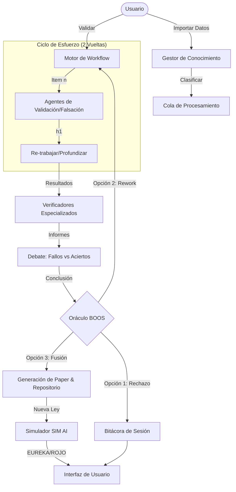

# BLUEPRINT TÉCNICO: SISTEMA DE VALIDACIÓN CIENTÍFICA MULTI-AGENTE (SVS) INTERACTIVO

## 1. INTRODUCCIÓN Y OBJETIVO
Este sistema es un **Centro de Validación de Teorías Físicas** diseñado para operar mediante lógica determinista y arquitectura multi-agente. Su propósito es procesar hipótesis científicas en bruto y, mediante un proceso iterativo de validación, falsación y debate, elevarlas a la categoría de **Leyes Fundamentales** publicadas en papers científicos.

## 2. ARQUITECTURA DEL SISTEMA
El SVS se basa en una arquitectura de **3 Capas**:

### A. Capa de Ingesta (KB Manager)
Permite la entrada de datos desde:
- Texto directo.
- Archivos locales (TXT).
- Enlaces de Google Drive (Simulado).
- Archivos ZIP.
- URLs de páginas HTML (Simulado).

### B. Capa Nuclear (Validación Dual)
- **Agentes de Ciclo**: Validator, Falsifier, Rework, DeepDive, Unifier.
- **Verificadores**: Math, Philosophy, Visual.
- **Debate**: Flaw vs Success Agents.
- **Oráculo (BOOS)**: El decisor supremo.

### C. Capa de Salida y Simulación
- **Paper Generator**: Prepriant, Translators (EN/ES), Reviewers.
- **SimAI**: Ejecutor de leyes para detección de **EUREKAS** o **DIVERGENCIAS**.

## 3. DIAGRAMA DE FLUJO (Mermaid)


## 4. ESPECIFICACIÓN DE LA INTERFAZ (UI)
La interfaz es una **Single Page Application (SPA)** reactiva construida sobre Flask y Bootstrap.
- **Panel de Control**: Permite encolar nuevas hipótesis y disparar manualmente cada ciclo de validación.
- **Bitácora de Agentes**: Un flujo de logs detallados que muestra el "pensamiento técnico" de la IA en tiempo real.
- **Visualizador de Debates**: Estilo conversación para entender los conflictos lógicos entre crítica y defensa.
- **Abstract de Sesión**: Un resumen ejecutivo que perdura tras el reinicio de la sesión para mantener la coherencia ontológica.

## 5. INSTRUCCIONES DE DESPLIEGUE
1. **Entorno**: Requiere Python 3.10+ y `Flask`, `pyyaml`.
2. **Ejecución**: 
   ```bash
   pip install flask pyyaml
   py main.py
   ```
3. **Acceso**: La interfaz estará disponible en `http://localhost:5000`.

## 6. LÓGICA DE EXPORTACIÓN Y PERSISTENCIA
- **Exportar**: Cada 5 iteraciones el sistema sugiere una exportación masiva en JSON o ZIP. 
- **Reseteo**: Al reiniciar, la bitácora detallada se purga pero se guarda un `Abstract` (JSON) con todas las leyes validadas en la sesión anterior.

## 7. CONSIDERACIONES DE ESCALA
Aunque este blueprint opera en memoria para el MVP interactivo, está diseñado para ser conectado a una base de datos **SQLite** o **PostgreSQL** reemplazando el diccionario de sesión por una tabla de persistencia de estados.

---
**PROPIEDAD DE ANTIGRAVYTI / RESONANCE AI**
